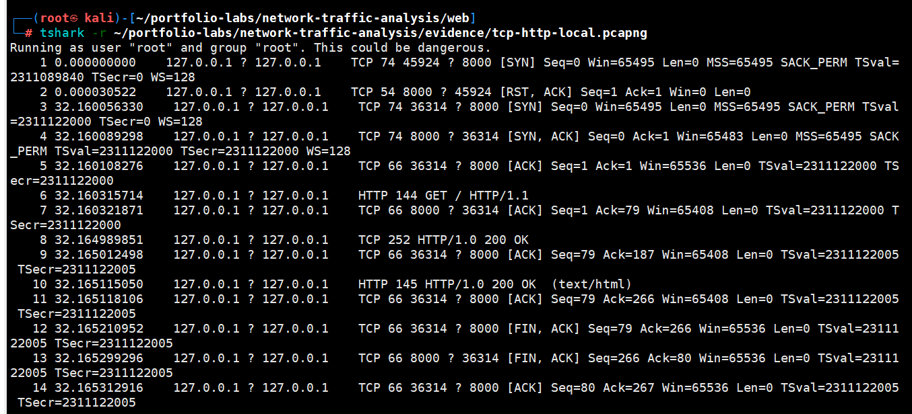
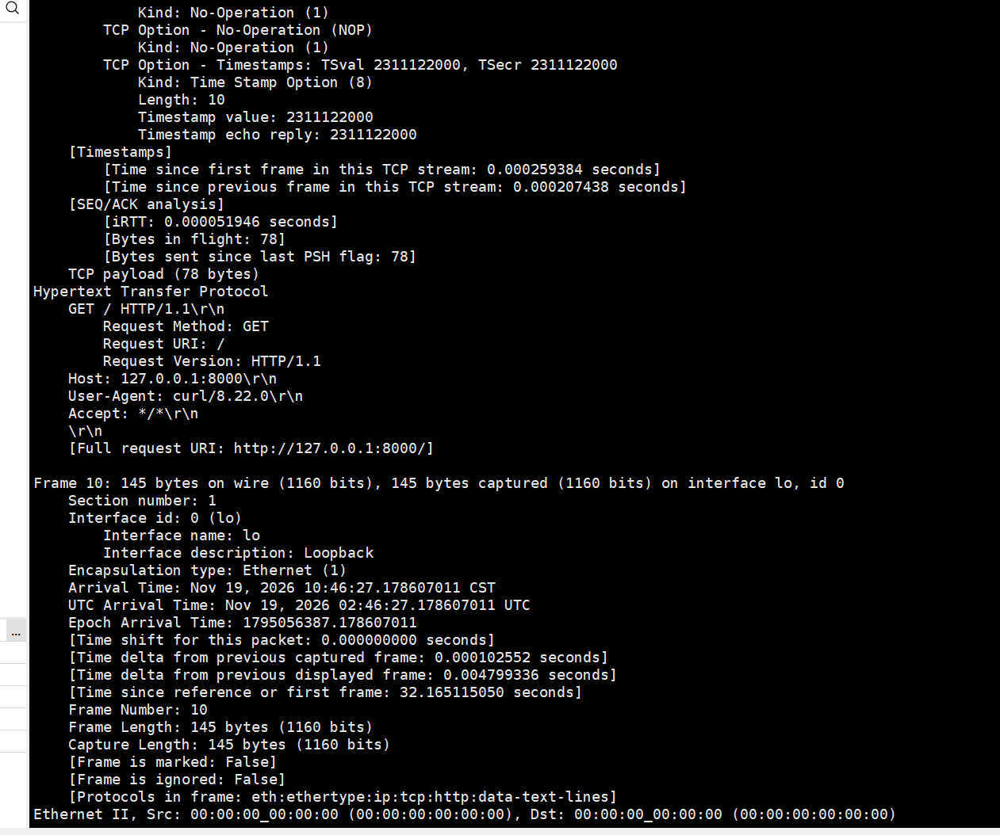
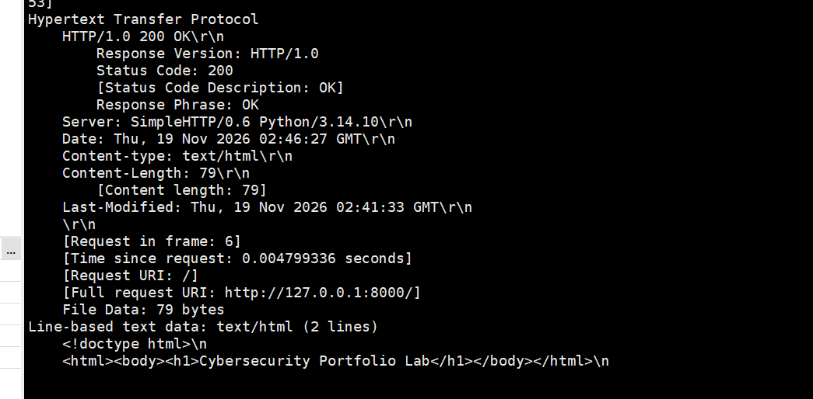
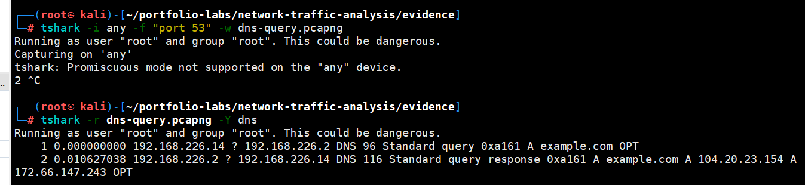
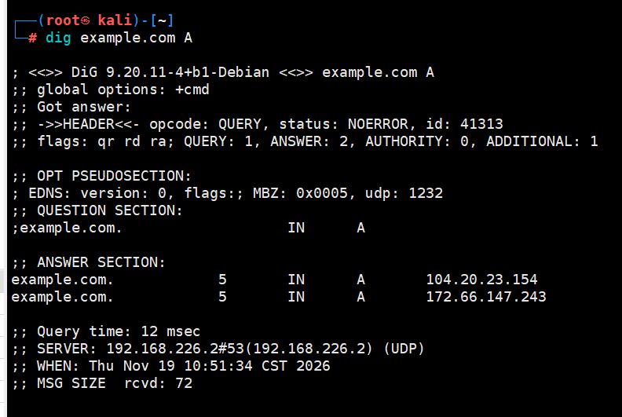

# Network Traffic Analysis and Protocol Investigation

## Project Status

Completed on 19 November 2026. Captures, analysis records, and screenshots are linked below.

## 1. Project Overview and Objectives

This project investigates TCP, HTTP, and DNS using packet evidence from my Kali Linux virtual machine. I used TShark, Wireshark's command-line packet analyzer, after the Wireshark graphical application could not connect to the session's display.

The objectives were to identify TCP connection establishment and termination, inspect HTTP requests and responses, match DNS queries with their responses, and use capture and display filters to investigate specific traffic. I also compared an unsuccessful TCP connection with a successful connection.

## 2. Environment and Tools

| Component | Laboratory configuration |
| --- | --- |
| Operating system | Kali Linux virtual machine |
| Capture and analysis | TShark |
| HTTP server | Python 3.14.10, standard-library `http.server` |
| HTTP client | curl 8.22.0 |
| DNS client | dig 9.20.11-4+b1-Debian |
| HTTP endpoint | `127.0.0.1:8000`, interface `lo` |
| DNS client and resolver | `192.168.226.14` and `192.168.226.2`, UDP port 53 |
| DNS capture | Interface `any`, filter `port 53` |
| Experiment date | 19 November 2026, China Standard Time (UTC+8) |

The HTTP client and server ran inside the same Kali VM and communicated over loopback. The DNS experiment used the VM's configured resolver to perform an ordinary lookup of `example.com`. The private addresses identify the laboratory endpoints in this experiment.

```text
Kali VM
  curl, client port 36314 <-- TCP over lo --> Python HTTP server, port 8000
  127.0.0.1                                  127.0.0.1

  dig, 192.168.226.14     <-- UDP/53 --> configured resolver, 192.168.226.2
```

## 3. Method

### TCP and HTTP capture

1. Created an HTML page containing the heading `Cybersecurity Portfolio Lab`.
2. Started the server from the directory containing the page.

   ```bash
   python3 -m http.server 8000 --bind 127.0.0.1
   ```

3. Started a capture in another terminal and kept it running during the request.

   ```bash
   tshark -i lo -f "tcp port 8000" -w tcp-http-local.pcapng
   ```

4. Generated the request from another terminal.

   ```bash
   curl --noproxy '*' --http1.1 -v http://127.0.0.1:8000/
   ```

5. Stopped the capture with Ctrl+C and inspected the packets.

   ```bash
   tshark -r tcp-http-local.pcapng
   tshark -r tcp-http-local.pcapng -Y http -V
   ```

### DNS capture

1. Captured DNS traffic while a second terminal performed the query.

   ```bash
   tshark -i any -f "port 53" -w dns-query.pcapng
   ```

2. Ran the lookup, stopped the capture, and inspected the query and response.

   ```bash
   dig example.com A
   tshark -r dns-query.pcapng -Y dns
   tshark -r dns-query.pcapng -Y dns -V
   ```

3. Exported text summaries and detailed protocol records. Generated SHA-256 checksums for both captures.

   ```bash
   sha256sum tcp-http-local.pcapng dns-query.pcapng > capture-checksums.sha256
   sha256sum -c capture-checksums.sha256
   ```

Capture filters selected traffic during recording. Display filters such as `http` and `dns` selected packets for analysis after capture.

## 4. Results and Analysis

### TCP connection establishment and termination

The TCP/HTTP capture contains 14 packets.

| Frames | Observation | Interpretation |
| --- | --- | --- |
| 1-2 | Client port 45924 sent SYN; port 8000 returned RST, ACK | The first connection attempt was rejected. The exact cause cannot be established from the capture alone. |
| 3 | Client port 36314 sent SYN to port 8000 | A new connection attempt began. |
| 4 | Port 8000 returned SYN, ACK | The server acknowledged the request and supplied its own initial sequence number. |
| 5 | Client returned ACK | The three-way handshake completed. |
| 6 | Client sent the HTTP request | Application data followed connection establishment. |
| 12-14 | FIN, ACK; FIN, ACK; ACK | The connection closed normally, with an acknowledgment combined with one FIN. |

The rejected attempt occurred approximately 32 seconds before the successful attempt. Comparing these exchanges helped me distinguish connection rejection from successful connection establishment.



### HTTP request and response

Frame 6 contains `GET / HTTP/1.1`, with `Host: 127.0.0.1:8000`, `User-Agent: curl/8.22.0`, and `Accept: */*`.

The server returned `HTTP/1.0 200 OK`. The response headers identify `SimpleHTTP/0.6 Python/3.14.10`, a Content-Type of `text/html`, and a Content-Length of 79 bytes. The returned HTML contains the laboratory heading.

The response is carried in frames 8 and 10, with TCP payload lengths of 186 and 79 bytes. TShark reassembles these into 265 bytes containing the HTTP headers and body. Frame 10 displays the reassembled HTTP response. The request uses HTTP/1.1 and the response uses HTTP/1.0, as shown by the recorded protocol fields.

The interval from the request to the reassembled response frame is approximately 4.8 ms. This measurement describes this local exchange.





### DNS query and response

The original DNS capture contains two packets. Kali at `192.168.226.14` queried `192.168.226.2` for an A record for `example.com`. Both packets use transaction ID `0xa161`, equivalent to decimal 41313 in the original dig output. The reverse source/destination addresses and matching ID associate the response with the query.

The response status is `NOERROR`. It contains A records `104.20.23.154` and `172.66.147.243`, each with a remaining TTL of five seconds. The capture interval is approximately 10.63 ms. The original dig output reports 12 ms, using its own timing measurement.

The separately saved `dns-dig-output.txt` records a later query at 10:53:22, with transaction ID 53886 and an 8 ms query time. The original captured exchange occurred at 10:51:34. The screenshot below preserves the original dig result. DNS answers and remaining TTLs may change between queries.





## 5. Evidence

| File | Purpose |
| --- | --- |
| [TCP/HTTP capture](evidence/tcp-http-local.pcapng) | Original 14-packet capture |
| [TCP/HTTP summary](evidence/tcp-http-summary.txt) | Frame numbers, endpoints, flags, and HTTP summary |
| [HTTP details](evidence/http-details.txt) | Detailed request and response dissection |
| [DNS capture](evidence/dns-query.pcapng) | Original two-packet DNS exchange |
| [DNS summary](evidence/dns-summary.txt) | Query-response pairing and answers |
| [DNS details](evidence/dns-details.txt) | Detailed DNS protocol fields |
| [Later dig output](evidence/dns-dig-output.txt) | Separately recorded repeat query |
| [SHA-256 checksums](evidence/capture-checksums.sha256) | Integrity values for the two original capture files |

The checksum values were verified against both capture files before publication. Captures contain the laboratory HTTP page and DNS lookup used in this project.

## 6. Challenges and Troubleshooting

The Wireshark GUI failed to start with `could not connect to display localhost:10.0` and a Qt platform initialization error. I continued using TShark to capture packets and inspect the protocol fields through the terminal. This allowed me to complete the experiments while retaining packet-level evidence.

TShark also reported that promiscuous mode was unsupported on the `any` interface. The capture still recorded the DNS query and response, which I verified by reading the saved file.

The initial TCP reset provided an additional troubleshooting observation. A future repeat would record server startup times alongside the packet timestamps to test whether the service was listening during the rejected attempt.

## 7. Limitations and Improvements

The loopback HTTP experiment does not measure communication across separate machines, routing devices, or a physical network. The DNS capture contains one query-response pair, so broader conclusions require additional observations.

I would repeat the HTTP experiment between two laboratory VMs, compare HTTP with HTTPS, and capture repeated DNS queries to investigate caching and TTL changes. I would also record exact capture-tool and OS versions before each run to improve reproducibility.

The short capture supports protocol analysis and troubleshooting. Investigating malicious activity would require additional context and evidence.

## 8. Conclusion

I used TShark to investigate TCP connection rejection, the three-way handshake, normal connection termination, an HTTP request and response, and DNS resolution. Comparing packet fields with application output strengthened my ability to explain network behavior using reproducible evidence.

[Return to portfolio]({{ '/' | relative_url }})
