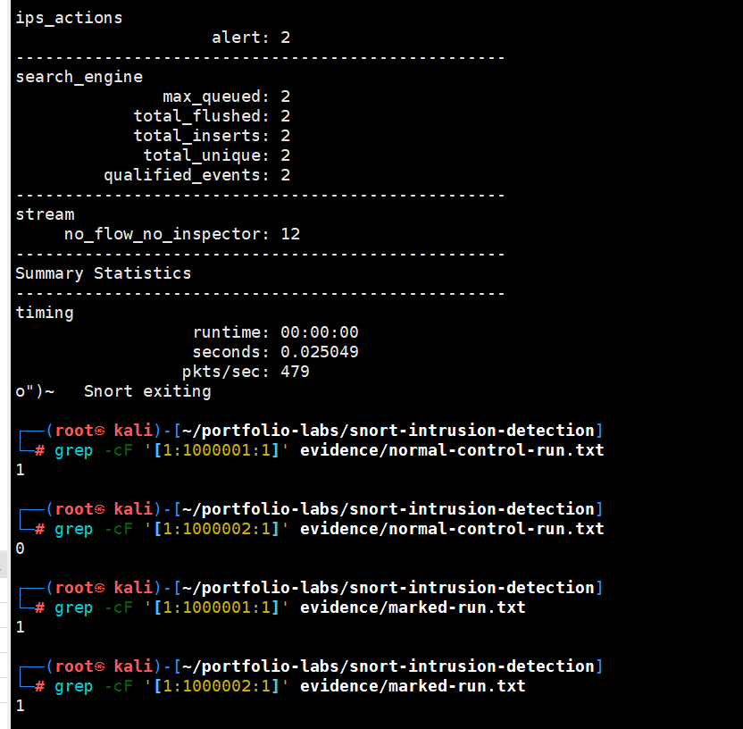
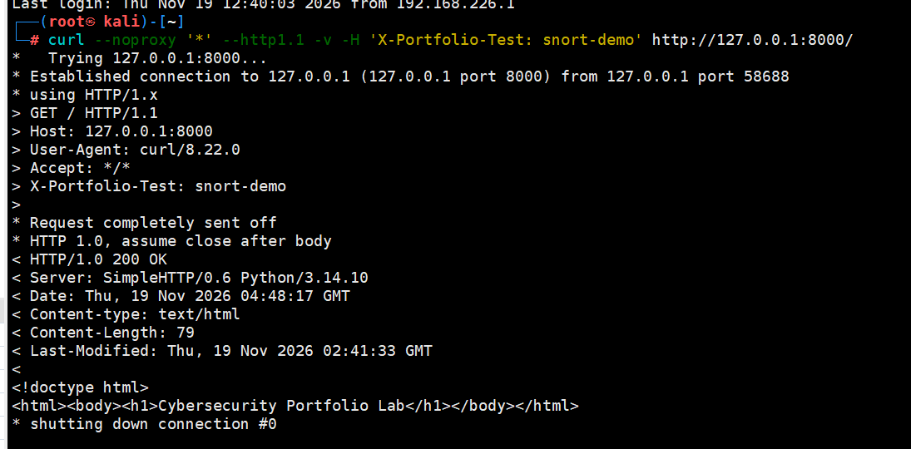
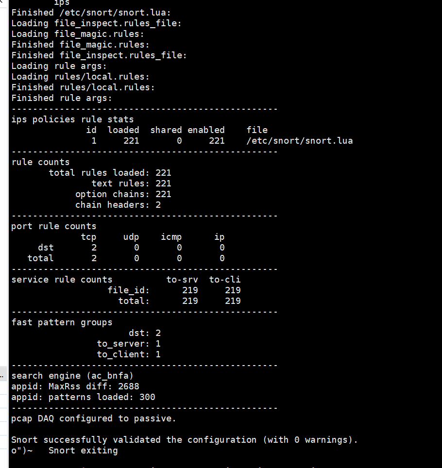
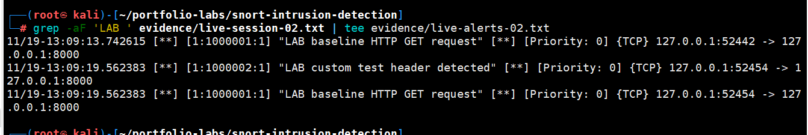
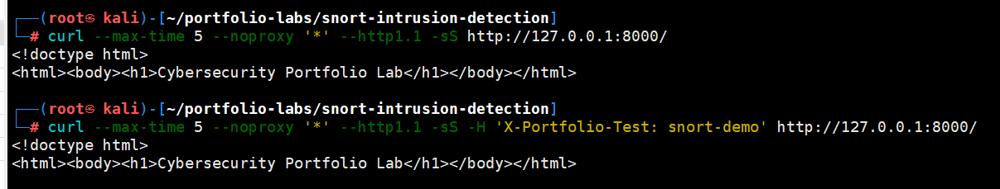

# Network Intrusion Detection and Alert Analysis Using Snort 3

## Project Status

Completed laboratory detection experiments on 19 November 2026. Offline results and live alerts are documented below. The recorded live session ends during shutdown, so final live packet statistics are unavailable.

## 1. Project Overview and Objectives

I used Snort 3 to detect controlled HTTP traffic in my Kali Linux virtual machine. I wrote two custom rules, compared ordinary requests with requests containing a laboratory marker, and verified detection through both saved packet captures and live monitoring.

The objectives were to validate rule syntax, configure Snort, inspect alert identifiers and endpoints, compare detection results with expected behavior, and evaluate the limitations of simple signature matching.

All requests targeted my own Python HTTP server at `127.0.0.1:8000`. The custom header was deliberately inserted as a benign test marker.

## 2. Environment and Tools

| Component | Configuration |
| --- | --- |
| Operating system | Kali Linux virtual machine |
| Detection engine | Snort 3.12.2.0, `/usr/sbin/snort` |
| Data acquisition library | LibDAQ 3.0.24, pcap DAQ |
| HTTP server | Python 3.14.10 standard-library `http.server` |
| Traffic generation | curl 8.22.0 |
| Packet capture and inspection | TShark and capinfos |
| Live recording | `script` terminal session recording |
| Monitored interface | `lo`, loopback |
| Server endpoint | `127.0.0.1:8000` |
| Base configuration | `/etc/snort/snort.lua` and `snort_defaults.lua` |
| Date and time zone | 19 November 2026, China Standard Time (UTC+8) |

```text
Kali Linux VM
  curl client  ---- HTTP over lo ----> Python HTTP server
  127.0.0.1                            127.0.0.1:8000
                       |
                  Snort 3 observes
                       |
              local.rules -> alerts
```

## 3. Custom Rules

The final [local.rules](rules/local.rules) contains two rules.

```text
alert tcp 127.0.0.1 any -> 127.0.0.1 8000 (msg:"LAB baseline HTTP GET request"; content:"GET / HTTP/1.1"; sid:1000001; rev:1;)

alert tcp 127.0.0.1 any -> 127.0.0.1 8000 (msg:"LAB custom test header detected"; content:"X-Portfolio-Test|3a 20|snort-demo"; sid:1000002; rev:1;)
```

Rule `1000001` detects the laboratory GET request. Rule `1000002` detects the literal header string `X-Portfolio-Test: snort-demo`; `|3a 20|` represents a colon followed by a space. Both rules generate alerts and have revision 1. Alert identifiers such as `[1:1000002:1]` contain the generator ID, signature ID, and revision.

These rules use TCP payload content matching. The header rule has fixed spelling and spacing, which limits its coverage. The alert label `Priority: 0` reflects the output from these laboratory rules, which do not specify a classification or priority.

## 4. Method

### Prepare and validate

1. Recorded the installed Snort version and located `/etc/snort/snort.lua`.
2. Reused the ordinary HTTP capture from my traffic analysis project and converted it into standard PCAP format.
3. Created the baseline rule, then added the marker rule.
4. Validated the final two-rule file.

```bash
snort -T -R rules/local.rules
```

The rule-only validation loaded two rules with zero warnings.

### Offline control experiment

1. Started the Python HTTP server bound to loopback.
2. Used the existing ordinary request as the negative control for the marker rule.
3. Captured one new marked request with TShark.

```bash
# Run in a separate terminal while sending the marked request.
tshark -i lo -f "tcp port 8000" -F pcap -w evidence/marked-http.pcap
```

```bash
curl --noproxy '*' --http1.1 -v -H 'X-Portfolio-Test: snort-demo' http://127.0.0.1:8000/
```

4. Stopped capture with Ctrl+C and ran the same final rules against both captures.

```bash
snort -R rules/local.rules -r evidence/baseline-http.pcap -A alert_fast -k none
snort -R rules/local.rules -r evidence/marked-http.pcap -A alert_fast -k none
```

`-R` selects the rules file, `-r` reads a capture, and `-A alert_fast` prints brief alerts. `-k none` skips checksum validation for this loopback laboratory analysis. The rule-only runs reported `no_flow_no_inspector`, documenting packet-level matching before loading the full configuration.

### Load the full configuration

```bash
snort -c /etc/snort/snort.lua -R rules/local.rules -T
snort -c /etc/snort/snort.lua -R rules/local.rules -r evidence/marked-http.pcap -A alert_fast -k none
```

The full configuration validated with zero warnings and loaded 221 rules: two custom TCP rules and 219 file-identification service rules. Its offline run recorded `stream_tcp` and `http_inspect` processing and produced the expected two custom alerts.

The [configuration snapshot](config/snort.lua) and [defaults snapshot](config/snort_defaults.lua) preserve the files used. Repeating the configured experiment requires a compatible Snort installation and its supporting rule and data files. The snapshots retain the original installation settings.

### Live monitoring

I ran Snort in passive mode on `lo`, waited for `Commencing packet processing`, and sent one ordinary request followed by one marked request. I recorded the successful repeat session with:

```bash
script -q -f -c "/usr/sbin/snort -c /etc/snort/snort.lua -R rules/local.rules -i lo -A alert_fast -k none" evidence/live-session-02.txt
```

In another terminal:

```bash
curl --max-time 5 --noproxy '*' --http1.1 -sS http://127.0.0.1:8000/
curl --max-time 5 --noproxy '*' --http1.1 -sS -H 'X-Portfolio-Test: snort-demo' http://127.0.0.1:8000/
```

After observing the alerts, I pressed Ctrl+C and extracted the matching lines into `live-alerts-02.txt`.

## 5. Results and Evidence

### Offline comparison

| Test | Packets analyzed | Rule 1000001 | Rule 1000002 | Total custom alerts |
| --- | ---: | ---: | ---: | ---: |
| Ordinary request, rule-only run | 14 | 1 | 0 | 1 |
| Marked request, rule-only run | 12 | 1 | 1 | 2 |
| Marked request, full-configuration run | 12 | 1 | 1 | 2 |

The ordinary capture includes an earlier rejected TCP attempt, accounting for two additional packets. The successful ordinary request used client port 36314. The marked request used port 58688 and received an HTTP `200 OK` response. Its request timestamp was 12:48:17.







### Recorded live results

| Time, UTC+8 | Client port | Request | Observed custom rules |
| --- | ---: | --- | --- |
| 13:09:13.742615 | 52442 | Ordinary GET | 1000001 |
| 13:09:19.562383 | 52454 | GET with test header | 1000001 and 1000002 |

The successful recorded live run contains three custom alerts. Both clients connected to `127.0.0.1:8000`, and both requests returned the laboratory page. The recording ends after `caught int signal` and `stopping`. It supports the observed alerts, while final live packet totals and completed shutdown are unverified in this recording.





### Downloadable evidence

| File | Purpose |
| --- | --- |
| [Final custom rules](rules/local.rules) | Two rules used for the comparison and live tests |
| [Initial baseline rule](rules/baseline.rules) | First one-rule experiment |
| [Two-rule validation](evidence/two-rule-validation.txt) | Successful final rule syntax validation |
| [Full configuration validation](evidence/full-config-validation.txt) | Zero warnings and 221 loaded rules |
| [Ordinary request capture](evidence/baseline-http.pcap) | 14-packet control capture |
| [Marked request capture](evidence/marked-http.pcap) | 12-packet positive-test capture |
| [Ordinary request detection log](evidence/normal-control-run.txt) | One baseline alert and zero marker alerts |
| [Marked request detection log](evidence/marked-run.txt) | One alert for each rule |
| [Configured offline log](evidence/configured-marked-run.txt) | Offline results with full configuration |
| [Comparison summary](evidence/detection-summary.txt) | Extracted offline alert counts |
| [Marked HTTP details](evidence/marked-http-details.txt) | TShark request and response dissection |
| [Recorded live session](evidence/live-session-02.txt) | Startup, alerts, and shutdown request |
| [Extracted live alerts](evidence/live-alerts-02.txt) | Three recorded custom alerts |
| [Original checksum manifest](evidence/checksums.sha256) | SHA-256 values for nine key files |

Run the checksum verification from this project's root directory:

```bash
sha256sum -c evidence/checksums.sha256
```

All nine entries were verified after transfer to Windows. The capture, rule, configuration, and log bytes were preserved.

## 6. Challenges and Troubleshooting

My first offline command referenced `baseline-http.pcap` before the conversion file existed. Snort reported a missing input file. I created the PCAP file with TShark and confirmed its 14-packet count using capinfos before repeating detection successfully.

An early live logging attempt produced an empty file. The available evidence did not establish its exact cause. I verified the Snort executable and full configuration directly, confirmed live alerts on screen, and then recorded a new session using `script`. Waiting for capture startup and generating fresh requests during recording produced the three saved alerts.

## 7. Detection Evaluation and Improvements

The marker rule matched the marked request and stayed silent on the ordinary request in this small experiment. The baseline rule intentionally matched both requests. Treating every baseline alert as an attack would produce an alarm for the legitimate control request.

These observations demonstrate signature behavior on the tested samples. A broader false-positive rate or detection rate would require more labeled traffic. The marker is benign and intentionally supplied, so its presence alone does not establish malicious activity.

The current rules depend on exact strings in TCP payloads. Changing header capitalization or spacing, splitting content across segments, or encrypting the HTTP exchange can affect visibility and matching. Although the full configuration enabled protocol processing, the custom rules still use generic payload matching.

I would improve the project by writing an HTTP-aware header rule, testing case and whitespace variations, and adding segmented and encrypted traffic cases. I would also repeat each control several times and preserve complete live shutdown statistics to improve reproducibility.

## 8. Conclusion

I validated custom Snort 3 rules, tested ordinary and marked HTTP requests offline, loaded the full configuration, and recorded alerts during live loopback monitoring. Comparing positive and negative controls helped me connect rule conditions with observed alerts and explain the limits of simple detection signatures.

[Return to portfolio]({{ '/' | relative_url }})
